 

 

## About

Front-end Engineer at **AAWZ Partners**, specialized in **JavaScript / TypeScript**, **Vue.js** and **React**. I turn complex products into clean, responsive and maintainable interfaces, working side by side with designers, back-end engineers and product.

I care about what makes a front-end last: component architecture, design systems, performance, testing and a great user experience.

 

## What I do

| | |
|---|---|
| **AI platform front-end** | Built the interface of an AI platform integrated with the financial market, CRM and internal tools, consuming REST APIs and agent/worker back-ends. |
| **CRM for investment advisors** | Designed and built a CRM used by investment consultants and advisors, and I support the tooling software for this audience. |
| **Code review and UX guidance** | I review code and share UX recommendations with the team, helping keep quality and consistency across the product. |
| **Recognized performance** | Highlighted as a top performer in my area for two consecutive semesters. |

 

## Tech Stack

 

| | |
|---|---|
| **Languages** | JavaScript, TypeScript, HTML, CSS |
| **Frameworks** | Vue.js, React |
| **UI** | Design systems, reusable components, responsive layouts, Tailwind CSS |
| **Quality & Tools** | Jest, Git, Docker, Vite, Figma |

 

## Let's connect

Open to conversations about front-end engineering, design systems and AI-powered products.

**[Reach me on LinkedIn →](https://linkedin.com/in/herikrodrigues)**

 

